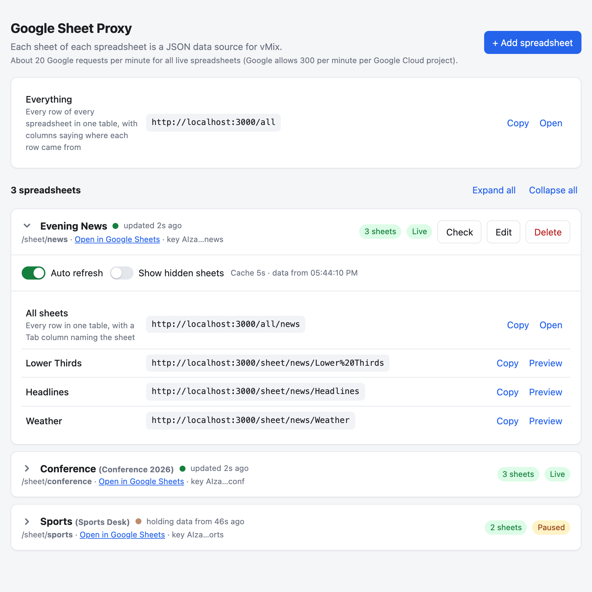

# Google Sheet Proxy for vMix

Connect one or more Google spreadsheets and serve every sheet in them as its own JSON endpoint, in the shape vMix Data Sources expects: an array of row objects, with the sheet's first row used as column names. You add and manage spreadsheets in a web interface.

<picture>
  <source media="(prefers-color-scheme: dark)" srcset="docs/screenshot-dark.png">
  
</picture>

This README uses Google's terms: a **spreadsheet** is the whole file, and a **sheet** is one of the tabs inside it.

No dependencies. You need Node.js 18 or newer.

## Setup

1. **Get an API key** for each spreadsheet. Several spreadsheets can share the same key.
   - In [Google Cloud Console](https://console.cloud.google.com/), create or pick a project.
   - Go to *APIs & Services → Library*, find **Google Sheets API** and enable it.
   - Go to *APIs & Services → Credentials → Create credentials → API key*. You can restrict the key to the Google Sheets API.
2. **Share each spreadsheet** as **"Anyone with the link → Viewer"**. An API key can only read spreadsheets shared that way.
3. **Start the proxy:**
   ```bash
   npm start
   ```
4. **Open http://localhost:3000** and click **+ Add spreadsheet** for each spreadsheet. Enter its URL and the API key to use for it.

Spreadsheets and their settings, including API keys, are saved in `config.json`. Keep that file private. Optionally, copy `.env.example` to `.env` to change the port or set an interface password.

## The interface

- **Spreadsheets:** add, edit or remove spreadsheets. Each spreadsheet has:
  - a name
  - the spreadsheet URL or ID
  - a *URL name* (slug) used in its JSON URLs
  - its own Google API key. The key is required when you add a spreadsheet and is shown masked once saved. When editing, leave the key field blank to keep the saved key.
  - a **cache time** in seconds (5 by default): how often the proxy re-reads the spreadsheet from Google
  - an **Auto refresh** switch
  - a **Show hidden sheets** switch (off by default): whether sheets hidden in Google Sheets are listed and included in `/all`
- Each spreadsheet card has an **Auto refresh** switch, so you can pause and resume without opening the edit dialog:
  - **Live:** the proxy re-reads the spreadsheet from Google every cache period in the background, whether or not vMix is asking.
  - **Paused:** vMix keeps receiving the last fetched data, and Google is not called. Use this to lock graphics while someone edits the spreadsheet. **Fetch latest once** updates the held data a single time without turning live refresh back on.
  - If the proxy restarts while a spreadsheet is paused, it fetches once on the first request and then holds that data.
- For each spreadsheet, every sheet is listed with its JSON URL, a **Copy** button and a **Preview** that shows exactly what vMix will see.
- With more than one spreadsheet, the cards start collapsed to one line each, showing the spreadsheet's name, status and Live/Paused. Every card header also shows a status dot and how long ago the data vMix gets was last updated, counting up every second:
  - The dot is green when polling is working, amber when Google is failing and vMix gets the last good data, red when there's no data at all, and dimmed when the spreadsheet is paused. It pulses each time new data arrives from Google.
  - While Google is failing, the header also shows when the next retry is. The age turns amber when updates have stopped coming through for more than a few poll periods.
  - Click a card's header to open or close it, or use **Expand all** / **Collapse all**. The page remembers which cards you opened, separately in each browser.
- The page updates itself every 3 seconds, so you see problems as they happen. This doesn't use any Google requests.
- At the top, the page estimates how many Google requests per minute all live spreadsheets use, and warns when that's close to Google's limit.

## When Google has problems

The proxy is built so that a Google problem never blanks your graphics or stops updates for good:

- **vMix never waits on Google.** Every request is answered from the proxy's cache straight away. While Google is failing, vMix keeps getting the last good data.
- **Polling never stops.** If a read fails, the proxy waits a moment and tries again: 2 seconds, then 4, 8, 16, and then every 30 seconds until it works. Once Google answers, normal polling resumes and the new data is picked up automatically.
- **The spreadsheet card shows what's wrong**, in plain words, while it happens:
  - A yellow notice means Google isn't answering but vMix still has data. It says what's wrong, how old the data vMix is getting is, and when the next try is.
  - A red notice means there's no data yet for vMix (for example a new spreadsheet with a wrong API key). vMix gets an error for that spreadsheet until it works.
  - After recovery, a smaller note shows how many errors there were in the last 10 minutes.
  - **Clear** on any of these notes resets the error counter, so the 10-minute count and any cache time suggestion start over. After recovery it also hides the note. While Google is still failing, it resets the retry wait and tries again right away. The error stays shown until a try succeeds.
- **Messages you may see:** Google not responding within 10 seconds, no internet connection, the connection being cut off, Google's request limit being reached, an invalid API key, access being refused (spreadsheet not shared or Sheets API not enabled), the spreadsheet not being found, or a temporary Google server problem. When Google gave its own explanation, it's shown underneath.
- **Cache time suggestions:** if Google fails 3 or more times in 10 minutes, the card suggests a longer cache time with a one-click **Use Ns** button. A longer cache time means fewer requests, which is the fix for "request limit reached" errors and makes the proxy ask less often during unreliable connections. Suggestions only count errors since the cache time was last changed. No suggestion is shown for errors a cache time can't fix, such as a wrong API key.
- **Check** tries Google right away instead of waiting for the next retry. On a paused spreadsheet it only re-reads the list of sheets, so the held data stays as it is.
- **Fetch latest once** keeps the previous data if Google fails, and tells you why.

## Using it in vMix

In vMix, go to **Settings → Data Sources**. Click **Add → JSON**, paste a sheet's URL such as `http://localhost:3000/sheet/results/Scores`, and set the auto-refresh interval.

To get everything from one data source instead, use `http://localhost:3000/all` (every sheet of every spreadsheet) or `http://localhost:3000/all/<spreadsheet>` (every sheet of one spreadsheet). vMix only accepts a single array of rows, so these return every row in one table. Extra columns show where each row came from:
- `Tab`: the sheet's name
- `Row`: the row's number within its sheet, the same number `/sheet/<spreadsheet>/<sheet>/<n>` uses
- `Sheet`: the spreadsheet's URL name (only on `/all`)

These column names and the URL paths are unchanged from earlier versions, so existing vMix data sources keep working.

For graphics that should always show one sheet's rows, the per-sheet URLs are simpler.

If vMix runs on another machine, replace `localhost` with the proxy machine's IP address.

## Endpoints

| Endpoint | Returns |
|---|---|
| `GET /sheet/<spreadsheet>/<sheet>` | All rows as `[{ "Header": "value", ... }]` |
| `GET /sheet/<spreadsheet>/<sheet>/<n>` | Only data row *n* (1 = first row under the header), still wrapped in an array |
| `GET /all` | Every row of every spreadsheet in one array, with `Sheet`, `Tab` and `Row` columns |
| `GET /all/<spreadsheet>` | Every row of one spreadsheet in one array, with `Tab` and `Row` columns |
| `GET /sheet/<spreadsheet>` | The spreadsheet's title and its sheets |
| `GET /sheets` | The configured spreadsheets |
| `GET /tab/<sheet>` | Shortcut to the first configured spreadsheet. This keeps URLs from the single-spreadsheet version working. |
| `GET /health` | `{ "ok": true }` |

- `<spreadsheet>` is the spreadsheet's URL name.
- `<sheet>` is the sheet's name, URL-encoded (for example `Lower%20Thirds`). The match is case-insensitive, and you can also use the sheet's 0-based position (`/sheet/results/0`).

The combined array has every column from every sheet. A row gets an empty value for any column its sheet doesn't have. If a sheet has its own column named `Sheet`, `Tab` or `Row`, that column is renamed with a `_2` suffix.

Add `?format=object` to get the grouped shape instead: `{ "<spreadsheet>": { "<sheet>": [rows] } }` on `/all`, or `{ "<sheet>": [rows] }` on `/all/<spreadsheet>`. This is useful for other tools, but vMix can't read it.

By default, sheets hidden in Google Sheets aren't listed in the interface, are left out of `/all`, and aren't polled in the background. A hidden sheet's own URL still works. To list them and include them in `/all`, turn on **Show hidden sheets** for that spreadsheet. The switch appears on the spreadsheet's card when it has hidden sheets, and is also in the edit dialog. Hidden sheets are then listed last, with a **Hidden** label. In Google Sheets, hiding a sheet looks a lot like deleting it, so if a sheet you removed still turns up, it's probably hidden. Unhide it from Google Sheets' *View → Hidden sheets* menu, or delete it for real.

On `/all`, a spreadsheet that fails to load (wrong key, missing spreadsheet) is left out, and the other spreadsheets still come through. With `?format=object`, the reason is listed under `_errors`.

The `/all` endpoints fetch every sheet of a spreadsheet in a single Google API call, and they follow each spreadsheet's cache time and Auto refresh setting. They share the per-sheet cache, so `/all` and the single-sheet URLs always serve the same data.

### Column names

vMix reads JSON through XML internally. Column names containing spaces, `#`, `/`, `|`, brackets, line breaks and similar characters are renamed by vMix to `a:item`, and all but the first such column are dropped. To avoid that, the proxy converts every column name to letters, digits and `_`:

| In the sheet | In the JSON |
|---|---|
| `Start Time` | `Start_Time` |
| `SESSION #` | `SESSION_Number` |
| `DURATION` + line break + `hh:mm:ss` | `DURATION_hh_mm_ss` |
| `DATA \| Countdown` | `DATA_Countdown` |
| `Q&A`, `Fjöldi %` | `Q_and_A`, `Fjoldi_Percent` |
| `Nafn ræðumanns` | `Nafn_raedumanns` |
| `2nd Speaker` | `_2nd_Speaker` (names can't start with a digit) |

vMix also treats `Name` and `NAME` as the same column, so names are made unique ignoring case. In `/all`, columns from different sheets that differ only in case (for example `Date` and `DATE`) are merged into one.

The Preview shows the names vMix sees, with the sheet's own name underneath when it differs. Add `?keys=original` to any URL to get the sheet's names unchanged (for tools other than vMix).

### Query options for sheet URLs

| Option | Effect |
|---|---|
| `?range=A1:D20` | Read only this range. The first row of the range is used as the header. |
| `?row=3` | Same as `/sheet/<spreadsheet>/<sheet>/3` |
| `?limit=10` | Return only the first N rows |
| `?raw` | Return the raw 2D array of cells, with no header mapping |
| `?render=unformatted` | Return raw numbers instead of the sheet's display formatting. `formula` returns the formulas. |
| `?empty=1` | Keep blank rows. By default they are skipped. |
| `?keys=original` | Use the sheet's column names exactly as written, instead of vMix-safe names |

`/all` and `/all/<spreadsheet>` accept `limit` (applied to each sheet), `render`, `empty`, `keys` and `format=object`. `raw` implies `format=object`.

## Notes

- **Security:** the interface and the `/api/*` endpoints can change settings. Set `ADMIN_PASSWORD` in `.env` to put them behind a browser login. The JSON data URLs stay open so vMix can read them. API keys are never sent back to the browser in full.
- **Google requests:** each live spreadsheet uses one Google request per cache period to read all its sheets, plus one a minute to re-read its list of sheets. This doesn't depend on how many vMix inputs are polling. Google allows 300 read requests per minute per Google Cloud project, shared by every spreadsheet whose API key belongs to that project. A request with `?range=` or `?render=` is read separately on demand, using the same cache time.
- **Header row:** blank headers become column letters (`A`, `B`, …). Duplicate headers get a suffix (`Name`, `Name_2`). Every row has every key, so vMix columns stay consistent.
